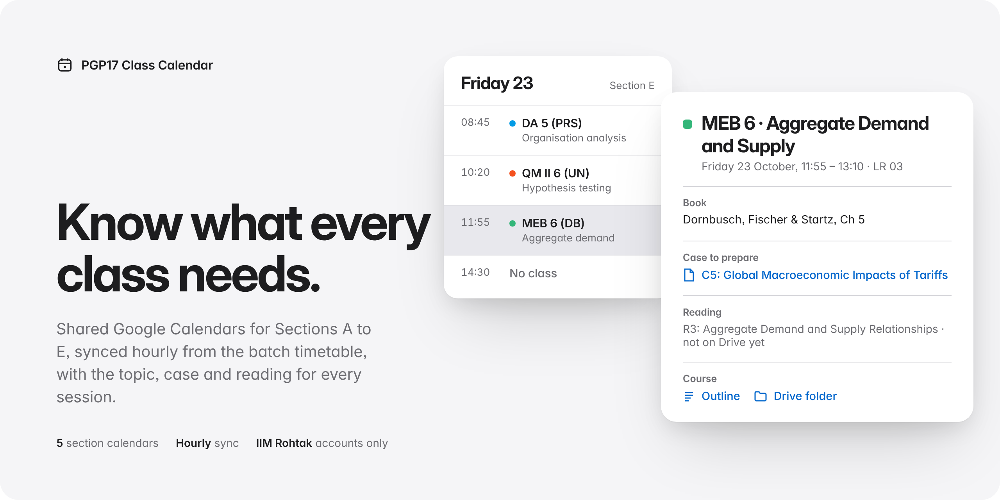
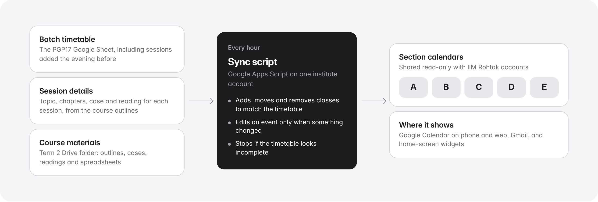

<picture>
  <source media="(prefers-color-scheme: dark)" srcset="images/hero-dark.png">
  
</picture>

# PGP17 Class Calendar

[](https://github.com/parvnar/pgp17-class-calendar-sync/releases)
[](v2/Code.gs)

Shared Google Calendars for every PGP17 Term II section. Each calendar is synced hourly from the batch timetable, and every class shows what to prepare for it. Add your section once; rescheduled, extra and cancelled classes then update on their own.

## Add your section

Sign in to Google with your **@iimrohtak.ac.in** account, then open your section's link. The calendars don't open for personal Gmail accounts.

| Section | Calendar |
| :-- | :-- |
| A | [Add Section A to Google Calendar](https://calendar.google.com/calendar/u/0?cid=Y182ZGJmMTc4ZTQ5MzU1YjI1YjZhOTkwMmQ5ODJmYzcwMDIxODdhNmEzZmVjOGE0OGM2M2Y4OGIwNDE5ZTYxMWNhQGdyb3VwLmNhbGVuZGFyLmdvb2dsZS5jb20) |
| B | [Add Section B to Google Calendar](https://calendar.google.com/calendar/u/0?cid=Y185NjNiYjkyNDQ3YmUxMzE3NzM0MmIxMTIxYzI2NTU1ZDI1MGUxYzA3ZDIyMDE0ZmEzNWUyZjFkNzIxZDE3MzZiQGdyb3VwLmNhbGVuZGFyLmdvb2dsZS5jb20) |
| C | [Add Section C to Google Calendar](https://calendar.google.com/calendar/u/0?cid=Y19hMTIzZTYwYzA2MjAwZWU1NjllNTI5Mzk3MTI4NzRhNmIyNTYyOWEwNWI4MmNlM2JjYTliNGM3N2M5ZTA0YmI1QGdyb3VwLmNhbGVuZGFyLmdvb2dsZS5jb20) |
| D | [Add Section D to Google Calendar](https://calendar.google.com/calendar/u/0?cid=Y18zN2M2MzEyZmFmMjViNzgwMGIyYjJiZWY4OWMwMTI3MDY4NWYxZTA5NDVmNDA0NTFmMzQ3MTY5YjExNTQ0MTdjQGdyb3VwLmNhbGVuZGFyLmdvb2dsZS5jb20) |
| E | [Add Section E to Google Calendar](https://calendar.google.com/calendar/u/0?cid=Y19lNTQxNjQ3MjNlMTE1ODJjZjc1MzQyOGNkY2ExMTcwNmVlMGIzYzM4MjM0YjhmYzk2ZTU0ZGMwOWNlNTg2ZmRlQGdyb3VwLmNhbGVuZGFyLmdvb2dsZS5jb20) |

<details>
<summary><b>On an Android phone</b></summary>

1. Open your section's link in **Chrome**. If the Calendar app opens instead, go back and stay in Chrome.
2. In Chrome, tap **⋮** and turn on **Desktop site**.
3. Check that the account at the top right is your institute account, then tap **Add**.
4. In the **Google Calendar** app, open **☰** and make sure *PGP17 Term II – Section X* is ticked.
</details>

<details>
<summary><b>On an iPhone</b></summary>

iOS can't subscribe to a Google calendar from a link. Add the calendar once from a laptop, then sign in to the **Google Calendar** app with the same institute account. The calendar appears there.
</details>

<details>
<summary><b>If the link doesn't work</b></summary>

On a laptop, open [Google Calendar](https://calendar.google.com/), choose **Other calendars → + → Subscribe to calendar**, and paste your section's calendar ID.

| Section | Calendar ID |
| :-- | :-- |
| A | `c_6dbf178e49355b25b6a9902d982fc7002187a6a3fec8a48c63f88b0419e611ca@group.calendar.google.com` |
| B | `c_963bb92447be13177342b1121c26555d250e1c07d22014fa35e2f1d721d1736b@group.calendar.google.com` |
| C | `c_a123e60c06200ee569e52939712874a6b25629a05b82ce3bca9b4c77c9e04bb5@group.calendar.google.com` |
| D | `c_37c6312faf25b7800b2b2bef89c01270685f1e0945f40451f347169b1154417c@group.calendar.google.com` |
| E | `c_e54164723e11582cf753428cdca11706ee0b3c38234b8fc96e54dc09ce586fde@group.calendar.google.com` |
</details>

## What each class includes

| Item | What you get |
| :-- | :-- |
| **Session** | Course, session number, faculty and room |
| **Topic** | What the session covers, from the course outline |
| **Book** | Chapters to read before class |
| **Case and reading** | Linked to the file in the course Drive folder, with any Excel or slide files alongside |
| **Course links** | The course outline and the subject's Drive folder |

Titles keep the timetable's short codes, such as `MEB 6 (DB)`, so they stay readable in widgets. Each course keeps the same colour throughout. A case or reading marked *not on Drive yet* gets its link automatically once the file is uploaded.

## How it works

<picture>
  <source media="(prefers-color-scheme: dark)" srcset="images/how-it-works-dark.png">
  
</picture>

One Google Apps Script, running on a single institute account, reads the timetable every hour and updates all five calendars:

- **Last-minute sessions.** Every class cell is read, including the afternoon slot and sessions added with their own time, such as `Mcomm 1 (DS) (16:05-17:20)`.
- **Prep follows the session.** If MEB 4 moves from Monday to Thursday, its case and reading move with it.
- **Changes only.** An event is rewritten only when its time, topic or links change.
- **Safe by default.** If the timetable comes back incomplete, the run stops before touching any calendar.

## Moving from version 1

If you set up the v1 script in your own Apps Script project, switch it off. Otherwise every class appears twice.

1. Open your v1 project in [Google Apps Script](https://script.google.com/home).
2. Replace the contents of `Code.gs` with [`v2/stop-v1.gs`](v2/stop-v1.gs) and save.
3. Run `stopV1AndClean` and allow access when asked.

It removes only the upcoming events v1 created. Your own events and past classes stay. Then add your section above.

## Troubleshooting

| Symptom | Fix |
| :-- | :-- |
| *You don't have access* | You're signed in with a personal account. Switch to your institute account. |
| Added, but not on your phone | In the Calendar app, open **☰** and tick *PGP17 Term II – Section X*. |
| Not in Gmail's side panel | Tick the calendar at [calendar.google.com](https://calendar.google.com/), then reload Gmail with Ctrl+Shift+R. |
| Every class appears twice | Your v1 script is still running. See [Moving from version 1](#moving-from-version-1). |
| A file asks you to request access | Open it while signed in with your institute account. |
| A class differs from the timetable | Calendars refresh hourly. If it's still wrong after an hour, open an issue. |

## For maintainers

The system runs from one account; nobody else needs a copy of the script. Setup and day-to-day upkeep are covered in [**v2/SETUP.md**](v2/SETUP.md).

```
v2/
  Code.gs              Sync script for all sections
  appsscript.json      Manifest; turns on the Google Calendar API service
  stop-v1.gs           Switches off a v1 install and removes its events
  SETUP.md             Maintainer guide
  tools/
    build_details.py   Builds the session-details sheet from the course prep plan
v1/                    The original per-person script and its guide
images/                Documentation images (light and dark)
CHANGELOG.md           Version history
```

Private IDs for the session-details sheet and the materials folder aren't stored in this repository. Changes are listed in [CHANGELOG.md](CHANGELOG.md) and on the [Releases](https://github.com/parvnar/pgp17-class-calendar-sync/releases) page.

---

<sub>Made by [Parv Nar](https://github.com/parvnar) for the PGP17 batch at IIM Rohtak. Not an official institute service.</sub>
